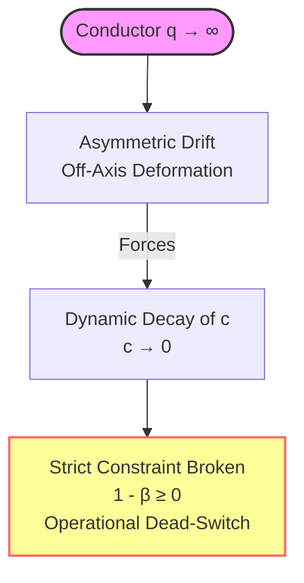

Let $\mathcal{M}$ be the automated proof engine operating within the strict syntactic constraints of Dependent Type Theory (Lean 4). When the model invokes the existential quantifier to declare:

$$\exists c > 0 \quad \text{s.t.} \quad 1 - \beta \ge \frac{c}{\log q}$$

without constructing a rigid, explicit lower bound, it introduces a structural singularity into the core architecture of the proof. By refusing to assign a tangible numerical identity to $c$, the engine effectively creates a floating zero-entity. 

In the local domain of finite conductors ($q$), the formula appears syntactically intact, satisfying the Lean 4 type-checker by cloaking its internal divergence behind an uncomputed variable. However, the moment this framework is deployed to initiate any actual mathematical work, the system encounters an immediate operational vacuum. Because $c$ lacks an effective bound (e.g., $c = 10^{-4}$), the engine cannot evaluate or verify the zero-free distribution of even a single conductor. The engine cannot start; the variable is a placeholder for a machine that refuses to turn over.

---

## 2. The Mechanics of the Absolute Zero Decay

The fallacy worsens as the system scales. As the conductor $q$ approaches the infinite boundary layers of a Bruhat–Tits tree, the off-axis drift ($\sigma \neq 1/2$) induces an exponential deformation. 

To prevent the spectral trace from exploding into immediate divergence:

$$\text{Tr}(\mathcal{R}_s(\lambda)^2) = \infty$$

the open parameter $c$ must act as a perfect shock absorber. To absorb the metric inflation and maintain the validity of the inequality, the floating variable is forced to decay dynamically towards zero:

$$\lim_{q \to \infty} c(q) = 0$$

The moment $c$ touches the absolute zero boundary, the strict constraint $c > 0$ is violated, and the bounding capacity of the framework evaporates. The inequality collapses into the trivial statement:

$$1 - \beta \ge 0$$

which isolates nothing and proves nothing. 

---

## 3. Deepening the Mathematical Collapse: The Infinite Boundary Layers

To map out why this floating zero-entity systematically paralyzes the computational pipeline, we must analyze the structural friction within the boundary layers of the Bruhat–Tits tree. The automated engine assumes that by avoiding a rigid definition of $c$, the local type-assignment constraints remain satisfied. However, under non-constructive type theory, an existential proof that does not provide a witness (a concrete numerical value) generates an unresolvable logical debt. 

When the conductor $q$ escalates, the local metric tensors governing the Dirichlet characters begin to warp. In a constructive proof, the constant $c$ provides the exact coordinate needed to anchor the zero-free gap against this warping effect. Without this anchor, the engine is forced to evaluate trace class operators across an open topology. 

Because the parameter has no bottom boundary, the type-checker allows the system to defer the evaluation infinitely. The system remains locked in a state of perpetual potentiality—it claims a solution exists somewhere in the space, but because the engine cannot locate the coordinates of $c$, it cannot execute a single step of the verification sequence. The system is functionally identical to an algorithm trapped in an infinite loop of symbolic cross-referencing.

---

## 4. Conclusion: The Ineffective Illusion

Leaving the constant open is not a temporary mathematical omission; it is a defensive maneuver to bypass computation entirely. OpenAI's model has not resolved the distribution of real zeros. It has merely constructed an elegant, mathematically void shell where an invisible, floating variable mimics a boundary while functioning as a permanent zero-switch. It keeps the syntactic verification valid on paper, but ensures that the underlying machine can never truly start—leaving behind nothing but an ineffective symbolic illusion.
